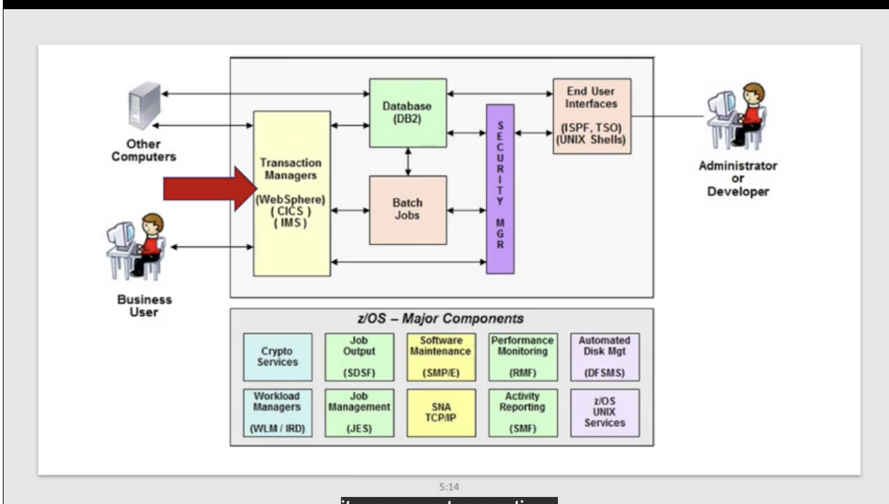

# Mainframe Environment

## Computer Architecture

Set of rules and mehtods that describe the functionality, organization, and implementation of the computer systems.

This includes software, hardware, and all items in between.

* Application software interacts with the user or a file, on top of the operating system.
* System software typically runs apart of the software, supporting applications that run using it.
* Firmware typically runs at the lower-level enabling the hardware to support software running on it. 
    * Instruction Set Architecture (ISA) describes the instructions which a CPC or processor can run.

## Mainframe Architecture

Memory is a unique difference, where the CPC (like a CPU) interacts with data from the on-board tightly coupled memory called "real storage."

1. Central / Real / **Physical** / Processor Storage - tightly coupled inside the CPC.
2. Auxiliary Storage (DASD/Tapes) - storage external to the CPC is loaded on DASD devices (like hardrives) or tape libraries. 
    * Asynchronous calls are made to the auxiliary storage unlike central memory.
    * Assigns isolated address spaces to different applications.
    * Has transparent & safer memory error recovery than traditional servers.

Part of the mainframe architecture is unique by how tightly coupled the physical & auxiliary storage is. This is why a lot of people refer to all this different memory as just "storage."

In the memory address spaces, memory is placed into four kilobyte chunks called **pages.** When a page is in physical storage, it occupies what is called a **frame.** When its moved out to AUX storage, it takes up a **slot** rather.

When the OS decides to move a frame to a slot, or a slot to a frame, its called **paging.** We want ideally as little paging as possible.

* Pages - are what memory is broken down into, 4kb chunks on z/OS.
* Frames - are what pages occupy when they're in the physical storage.
* Slots - are what pages occupy when they're in the AUX storage.
* Paging - is the process of moving the pages inbetween slots & frames.

## Virtualization

Physically you have the resources described above, but we organize these into logical systems called LPARs. (Logical Partitions.) 

Upon configuration we give these LPARs different levels of resources based on our needs.

Our processors can be used for different functions, and 

* Central Processor (CP) - runs OS and applications.
* System Assist Processor (SAP) - helps link between the CP and the I/O, moving around data in the system, allowing the CP to focus on running applications.
* Integrated Facility for Linux (IFL) - special licensing that helps run Linux for cheaper rather than on the CP.
* z Systems Integrated Information Processor for Linux - for certain workloads like Java you can offload work onto this type of processor.

I/O adapters are identitified by Channel Path Identifiers (CHPIDS), whereas the physical ports they connect into are identified by the Physical Channel ID (PCHID). 

CHPIDS are a connection between the physical port location and the subsystem, which could be a device like a storage devices, NAS, network adapters or another LPAR.

CHPIDS can be dedicated to one LPAR, unshared between multiple LPARs but unconfigurable (one connection at a time,) or "spanned" which can be associated with partitions from multiple logical subsystems.

**z/VM** is also a product, which is an operating system on its own. It is a type-1 hypervisor which runs baremetal to host virtual machines of any instance type including another z/VM nested.

## What are Operating Systems?

A collection of programs that manage the internal workings of a computer, rather than user applications. These systems support the operation of applications.

APIs are exposed for applications to make calls to perform system functions.

A process will typically go through the following stages:

* New - the process is being created.
* Ready - created, but the CPU is busy doing something else.
* Running - the CPU grabbed the process and is actively working it.
* Waiting - the process is waiting for resources, such as data, sub-processes, etc.
* Terminated - the process accomplished the task or errored, and there's nothing else for it to do.

Interrupts - the CPU sometimes has to go away to do other tasks, and will return a running process back to ready.

OS Responsibilities:

1. Process Management
2. Security Management
3. File Management
4. Network Management
5. Resource Management
6. Memory Management

## Mainframe Operating Systems

When the mainframe moved to the Z Architecture, it took with it new Z/ operating systems that run in 64-bit now.

* **z/OS** - flagship IBM OS. Descends from OS/360. Runs a mix of workloads efficiently while ensuring security and reliability.
* **z/TPF** - Transaction Processing Facility. Credit card processors, travel booking, etc.
* **z/VM** - Virtual machine hypervisor, type-1, runs baremetal directly on the machine.
* **z/VSE** - lesser used, mostly by smaller companies, a more simplified z/OS that requires less people to use. Batch & transactions.
* **Linux on IBM Z** - dedicated Linux operating system for IBM Z machines.
* **KVM on Z - (Kernel-based Virtual Machine)** this is an open-source hypervisor that works better when scaling with other KVM instances on other machines. Used often for distributed workloads.

Z/OS excels in different types of workloads, mainly batch processing and transactions. Z/OS is made up out of components, system components which are required, or addons that are bought and used per company.

* Transaction Manager (WebSphere / CICS / IMS)
* Database (DB2)
* Batch Jobs
* End User Interfaces (ISPF, TSO, UNIX Shells)
    * 

Major Components:

- Crypto Services.
- Job Output (SDSF)
- Software Maintenance (SMP/E)
- Performance Monitoring (RMF)
- Automated Disk Management (DF SMS)
- Workload Managers (WLM / IRD)
- Job Management (JES)
- SNA TCP/IP
- Activity Reporting (SMF)
- z/OS UNIX Services

Crypto services decrypt and encrypt data.

A job is a program with a specific input / output. The program doesn't change run-to-run, but the data does. The **Job Control Language (JCL)** defines how the Job will run, and then its submitted to the **Job Entry Subsystem (JES).** The **System Display & Search Facility (SDSF)** allows the operator to view the job output.

**SMP/E - System Modification Program / Extended** allows us to keep track of dependencies and modifications to software running on the mainframe. 

**RMF - Resource Measurement Facility** keeps track of trends, patterns, and current metrics on resource usage.

**DFSMS - Data Facility Storage Management Service** automates and centralizes data & storage administration.

**WLM - Workload Manager** makes sure when multiple things are running, they all get a fair slice of resources. You start by defining goals and the WLM tries to achieve that goal through dynamic situations.

**SNA TCP/IP - Systems Network Architecture Transmission Control Protocol / Internet Protocol** is where all the network communication lives and is manages.

**SMF - Systems Management Facility**keeps a standardized output and log of everything happening on the mainframe.

**UNIX Services** has USS with a POSIX standard environment, allows for running scripts, utilities, tools etc. This is not an OS, it is a Linux environment within z/OS. It can even interact with the system like submitting z/OS jobs from a UNIX shell.