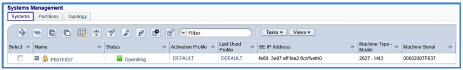
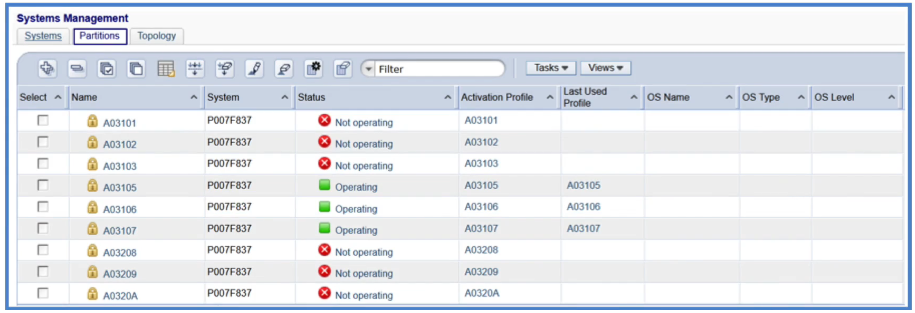
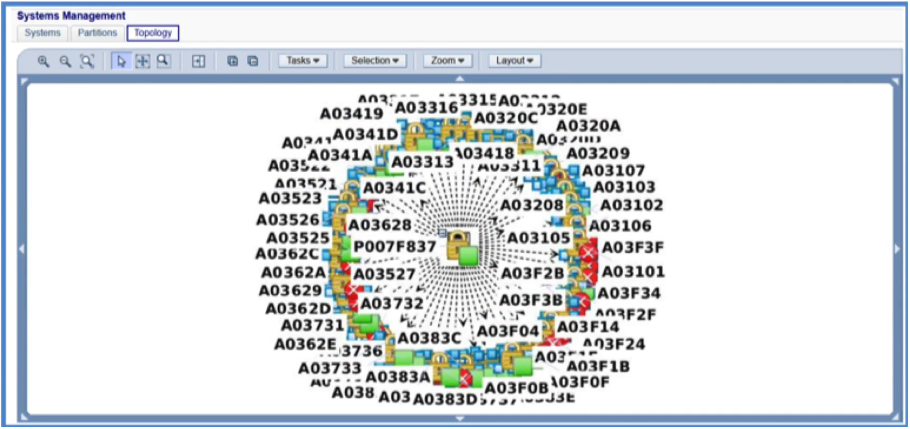
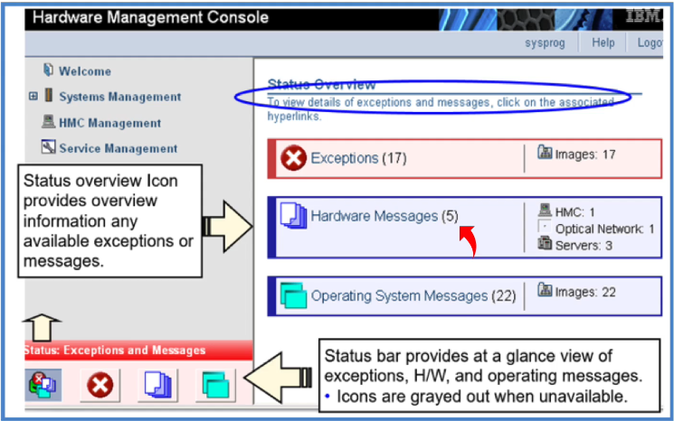
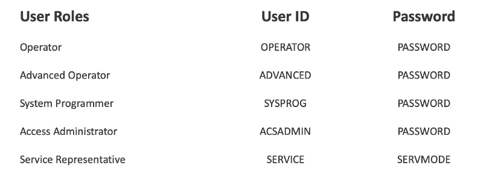

# Mainframe Infrastructure

## IBM Z Components

CPC - Central Processor Complex, contains processors, main storage, channels, etc. This is a pull-out drawer. 

PCIe fanout, peripheral component interconnect express. Connects the CPC drawer with a bunch of cables to I/O devices. The mainframe will have over a dozen drawers for add-on cards here with components like networking, cryptography, AI-acceleration cards, etc.

* IBM Telum II - model of processor.
* IBM Spyre - model of AI inference chip, similar to a GPU but specifically for AI workloads & IBM Z.

Hardware Management Appliances (HMA) are used to configure & reboot these systems. Inside the HMA there will be two components:

* Hardware Management Console (HMC)
* Support Element (SE)

For example, if there's a network card used for LPARs 1 & 2, we could extend that to LPARs 3 & 4 with the HMC.

## Mainframe (Unique) Features

* Processing AI models on the Telum 2 & Spyre chips are extremely powerful.
* IBM Concert for Z - Key Performance Indicators & Metrics for how the mainframe is running.
    * Integrated Command Console.
    * AI Suggestions
* Quantum-safe Cryptography
    * z/OS Encryption Readiness Toolkit (ZERT)
    * Application Discovery & Delivery Intelligence (ADDI)
    * Unified Key Orchestrator
* System Recovery Boost

Most environments will have multiple LPARs across multiple physical systems, allowing for a rolling IPL which takes some systems down while others may keep running. System Recovery Boost allows for the computer to use otherwise-restricted processors to get the computer up & running again.

## Millicode

Millicode is micro-architecture, layer below the principles of operation & above the hardware which changes with each release of the Z system. Makes it so the systems above in the OS / Applications don't have to change frequently. Initial machine load steps are implemented with millicode, as is parts of virtualization. To divide the systems up into different LPARs using different operating systems, you need an instruction called the Start Interpretive Execution (SIE) which is implemented in millicode. 

## HMC & SE

There are two support elements in a mainframe system, this is the screen and keyboard interface to the physical system aside from the HMC. The HMC allows us to access the SE's functions remotely. Multiple mainframes can be accessed from the HMC. You can add a mainframe to multiple HMCs as well. So, SEs are attached to the system, but HMCs are the remote entrance for any/all configured systems.

These allow us to start, stop, create & reconfigure LPARs.

### Physical Systems

### Logical Partitions

### Topology Map

### Status Overview

An exception is an unacceptable status that needs to be checked out ASAP. This could be a problem with an LPAR or any other objects like a network or cryptography card.

A hardware message is just when hardware components saw something worth noting to the operators, but it is not damaging so it does not throw a full exception. Same for operating system messages for OS software.

### The Support Element Contains:

1. Licensed Internal Code (LIC) that is used to control & monitor the CPC.
2. Logging & problem determination functions.
3. Hardware system definitions for server, activation profiles for startup.
4. IOCDS that is used for POR time. Tells the mainframe how to configure all the I/O & LPARS.
5. BOC to set CPC TOD clocks at POR time. (Time synchronization.)
6. Ethernet adapters for connectivity. 

### HMC/SE User Roles (default, can be added to):

## The Sysplex

Mainframe architecture is specifically unique in the way the Sysplex can share resources and work together efficiently.

* STP - Server Time Protocol, synchronizes time across LPARs. All LPARs must be in exact agreement on time.
* GRS - Global Resource Serialization, allows LPARs to access the same resources concurrently, serializing where necessary to enable exclusive access.
* XCF - Cross-Coupling Facility, manages communication between applications in a sysplex. Allows command executions from one LPAR to target another.
* Coupling Links - connect LPARs to processors. Allows for memory access between systems.
* CDS - Coupled Dataset, allows the different LPARs to work on the same sets of data without corruption. Contains information related to the parallel sysplex systems' working on these files.

The WLM (Workload Manager) uses the Sysplex resources to balance things out.

* Monoplex - one LPAR.
* Base Sysplex - every multiple LPAR in the plex is connected to each other.
* Parallel Sysplex - every multiple LPAR in the plex is connected to a Coupling Facility LPAR.

Rolling IPLs in a parallel sysplex allow for different LPARs to get shut down and rebooted with less downtime for the overall system. 