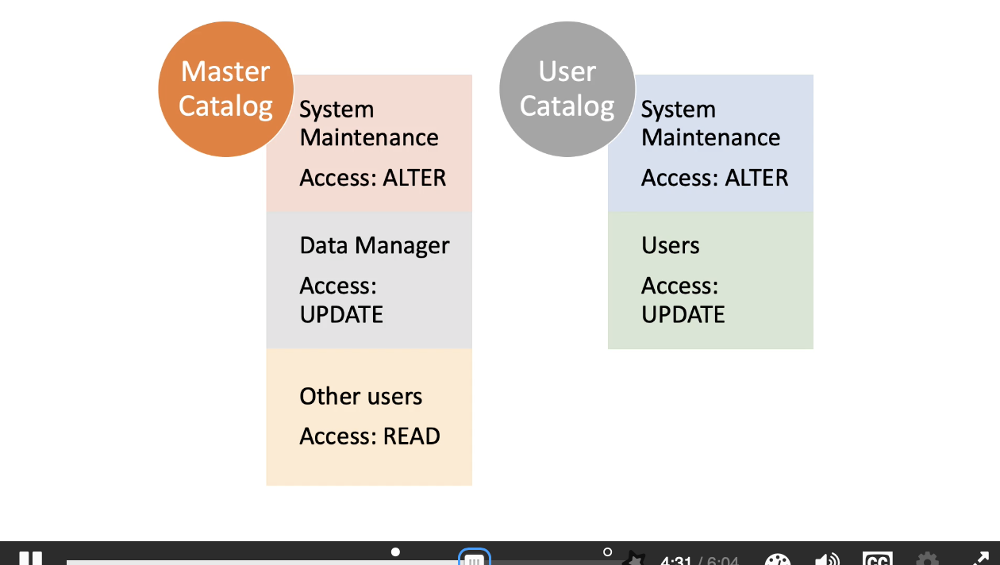
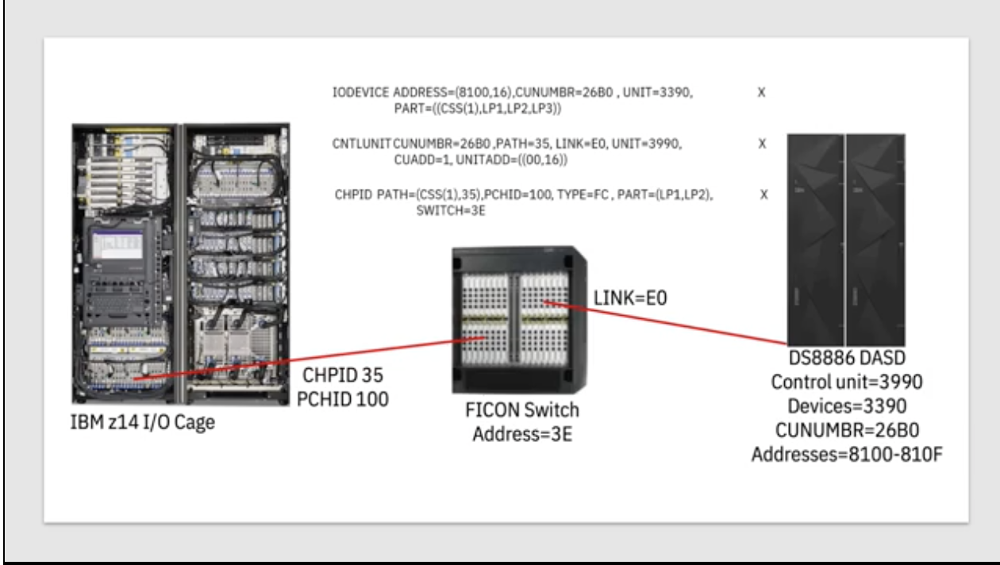
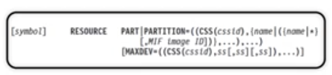
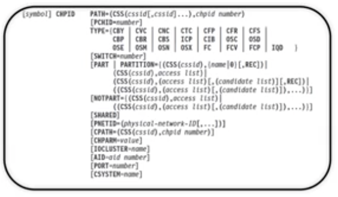
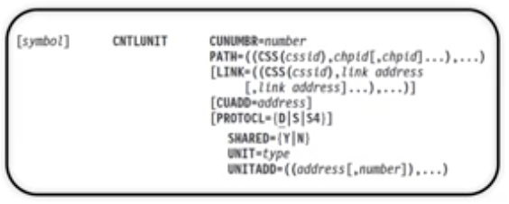
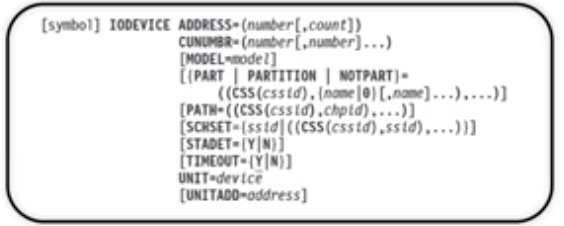
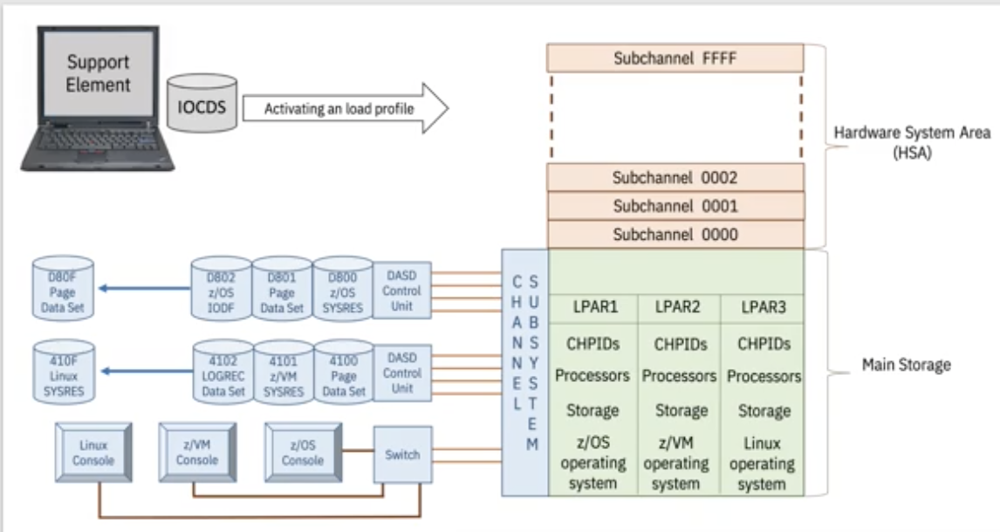

# Mainframe Security

## z/OS Security

- Confidentiality - the part that limits access.
- Availability - parts ensuring access availability.
- Integrity - parts ensuring the resources aren't wrongly modified.


A user makes a request to say "I want to do this thing." The **resource manager** decides first whether to route the request from the user to the resource it wants to get to.

The **System Authorization Facility (SAF)** recieves a request from the resource manager, which acts as a router to the correct systems to determine whether the user should have the access to make that request.

**RACF, or the Resource Access Control Facility,** is one product which could be used to determine acccess. RACF consults the RACF database records to see if that user is able to access that resource. RACF also logs all attempts of access which can be loaded into SMF to generate reports.

This work is offloaded from the main processors and given to other hardware like the 4767 Cryptographic Co-processor. This is an example of a PCIe card in the I/O section of the frame, and is also called a **"Hardware Security Module" or HSM.**

This PCIe card supports the highest level of security (four) for the Federal Information Processing Standard (FIPS.) If the card was wrongfully stolen from a frame, it would erase all the data on it when the tampering is detected. The physical controls prevent all tampering to gain access to the data.

## Security Addendum

The login for user can be a password (<= 8 characters,) or a passphrase (> 8 characters.)

A RACF user profile typically contains.

* User ID
* Owner of the ID
* Password / Passphrase
    * Encrypted, admin can reset but not see it.
* Special Attributes
    * Can allow for executing security commands other users can't.
* Groups
    * A user can belong to multiple groups.
    * A group can belong to a user or a group.

Access Authorities (to Datasets):

- Alter (Full CRUD)
- Control (Creation, Deletion, Renaming+?)
- Update (Read/Write, no delete.)
- Read
- Execute (for the loadlib, open for execution.)
- None

Catalog - a list of commonly used datasets. Different users may need different authorities to the same types of objects.



Discrete profiles control access to a single dataset. Generic profiles control access to a group.

To build & maintain a group of users that have access to a resource, we use the permit command. You can only use the permit command on a resource if one of the following are true:

- have the special attribute.
- have a profile within the scope of a group where you have the spec attribute.
- your user owns the resource.
- if the resource is a dataset and the high-level qualifier is your user ID.

## Transaction Level Security

Encryption & decryption is used to scramble the information in transactions so that it may not be decoded by hackers. These are key-based.

Symmetric Encryption - both encrypts & decrypts data. Hard to scale up while keeping it secure.

Public Key Cryptography - A public key is used to encrypt a message, but only the private key is used to decrypt it.

CPACF - CP Assist for Cryptographic Functions. Symmetric key functions are what this is built for, and it can help speed up things like VPN, SSL, and data storing applications..

Crypto Express PCIe Card - dedicated card for more advanced cryptographic functions.

Starting at z14 they introduced pervasive encryption, which would allow the data to be managed while still remaining encrypted, only decrypting it when absolutely necessary.

## Secured Keys vs. Protected Keys

* Secured Key - remains on the PCIe card forever.
* Clear Key - the key gets moved to storage for performance reasons. Can be read by people with certain privelidges.
* Protected Keys - enabled from the Crypto Express card, exists just there, but is wrapped with a transport key or LPAR-specific key. 

The wrapped key is transported over to the z/OS environment where it can be used by the CPACF. The CPACF can use the transport/LPAR-specific key, then do very high-performance encryption & decryption using that key. 

## IOCDS

Disk storage outside of memory is managed by Direct-access Storage Devices (DASDs). These can be mainframe-sized cabinets full of drives.

Input Output Configuration Data Set (IOCDS) - the connection between the resources and the systems that use them. Basically anything outside to inside connection with the mainframe.

When you define the IO configuration with a resource, you define the physical and logical information about those resources.

Input/Output Subsystem (I/O Subsystem) controls the channel operations. This requires information about the hardware I/O configuration.

To define this, the Input/Output Configuration Program is used, also called the IOCP. The IOCDS is built through a series of statements, brick-by-brick.

The IOCDS is stored on the Support Elements (SEs), and then picked up when the system is powered on.

To use IOCP to build an IOCDS, you need to know:

1. What the LPARS are that you want to work with.
2. What channels are linking the different LPARs, their physical ports on the I/O cards.
    * Channel Paths each have a CHPID. (Logical.)
    * The paths exit the mainframe from a physical port with a PCHID.
3. Control Units are attached to Channel Paths, which drives the device we're connecting to. Offloads work from the mainframe.
4. Input/Output Device, the thing we're trying to talk to, which the control unit is tasked to control.

There's 5 IOCP statements:

1. ID (optional)
2. Resource (required)
    * defines LPAR names
    * or if sharing channels between LPARs, you can define a Multiple Image Facility Image ID (MIF ID).
3. CHPID (optional)
    * Logical Channel Subsystems (LCSS) - we can create up to four of these to partition channels. Makes for up to 4x more CHPIDs possible.
    * Defines all channels on the system. (Logical connections between LPAR & PCHID.)
4. CNTLUNIT (optional)
    * Needed to connect to a device through a control unit.
    * Defines characteristics of the control unit.
    * Defines channel paths the control unit is connected to.
    * Defines unit addresses the Control Unit recognizes.
5. IODEVICE (optional)
    * Needed to talk to something.
    * Need the I/O device number, device characteristics, and the associated control units.



*A FICON Switch is a networking switch designed to connect IBM Z mainframe computers to high-speed storage devices, tape systems, and other mainframes.*

### ID Statement


The messages get printed out by the IO configuration reports. The X on the right side of the below statement denotes a continuation into the next line. Only SYSTEM is required OR (LSYSTEM AND TOK).

```
ID MSG1='IOCDSA2',MSG2='UPDATED MAY 2019',        X
        SYSTEM=(3906,1)
```

### Resource Statement 



PART defines the channel subsystem ID. We also define LPARs in this statement, or optionally a MIF ID. We can give it a default value as well as we did with `LP2` (LPAR 2) below.

```
RESOURCE PART=(CSS(1),(LP1,2),LP2,(LP3,5))
```

### CHPID Statement



```
CHPID PATH=(CSS(1),35),PCHID=100,TYPE=FC,PART=(LP1,LP2),       X
        SWITCH=3E
```

### CNTLUNIT Statement



```
CNTLUNIT CUNUMBR=2680,PATH=35,LINK=E0,UNIT=3990,       X
            CUADD=1,UNITADD=((00,16))
```

### IODEVICE Statement



```
IODEVICE ADDRESS=(8100,16),CUNUMBR=2680,UNIT=3390,      X
            PART=((CSS(1),LP1,LP2,LP3))
```

## Activation Profiles

Initial Program Load (IPL) - Loads a copy of the operating system from the system resident storage into main storage and executes it.

Power on Reset (POR) - Loads the IOCDS from the SE hardrive into the hardware systems area (HSA) and creates subchannels for each device defined in the IOCDS.

* A POR will stop everything on every LPAR in the sysplex, so it is not often and is planned far in advance.

Four types of activation profiles:

- Reset - determines how the licensed internal code is loaded, and how much central and expanded storage it will get.
- Image - for each LPAR, this defines LPAR parameters like how many processors & memory it will get. It will define if those processors are dedicated exclusively or shared with other processors.
- Load - needed to determine the channel addresses of the device that the OS will be loaded from.
- Group - allows for grouping of an object's activation profile with others so that every time it is activated, you don't need to change the profile. These profiles are optional, but can make managing the activation objects easier.

During the activation of a reset activation profile, if the mainframe is powered off, it'll begin powering up all of its components. Next, the IOCDS gets loaded into the hardware storage area and all of those logical definitions start getting made.

The subchannels which the LPAR is used to communicate over those channels start coming online, and we start getting our LPARs and CHPIDs and all the logical connections between them.

Then the activation profile gets loaded and there's one of these for each LPAR, this brings online the processors, and the storage defined for each LPAR. Then finally the load profile, meaning the LPAR starts to get its operating system and it's coming online.

That is the full process from POR to IPL.



## Initial Program Load (IPL)

