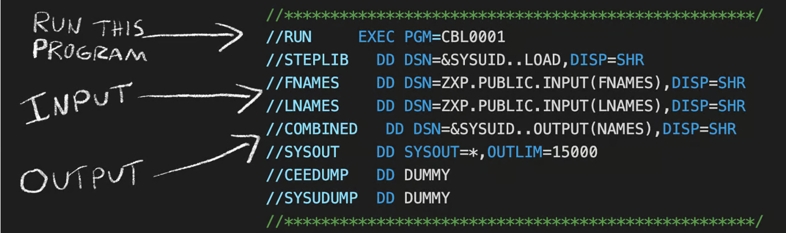

### Files / Datasets

In the Zowe Explorer on VSCode, the Sequential DS will show up almost like a file, where the Partitioned Data Sets will show up like a folder with members that look like files.

* Sequential Datasets (Physical Sequential or PS) - stores records in a strict linear order, must be read start-to-finish.
* Partitioned Data Sets (PDS) - like a folder, containing a directory and multiple independent sub-files called "members."
    * Members - places where the data can go. Can be accessed directly unlike PS data.
    * Records - each line in the member of a partitioned dataset.

### JCL (Job Control Language)

